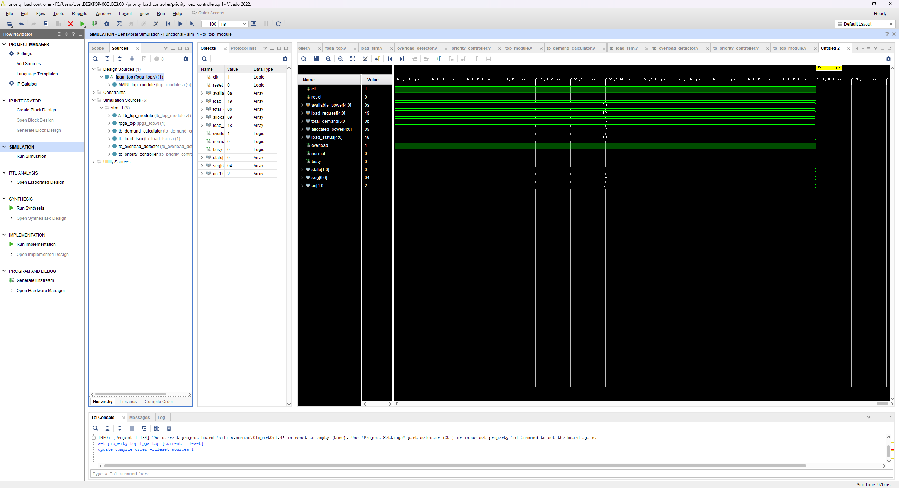
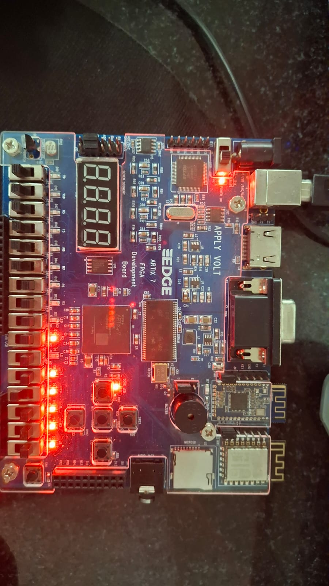
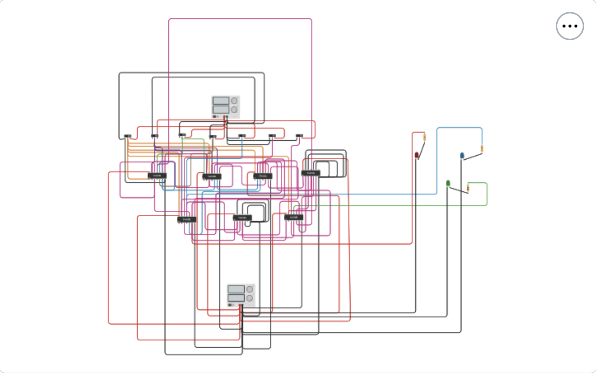
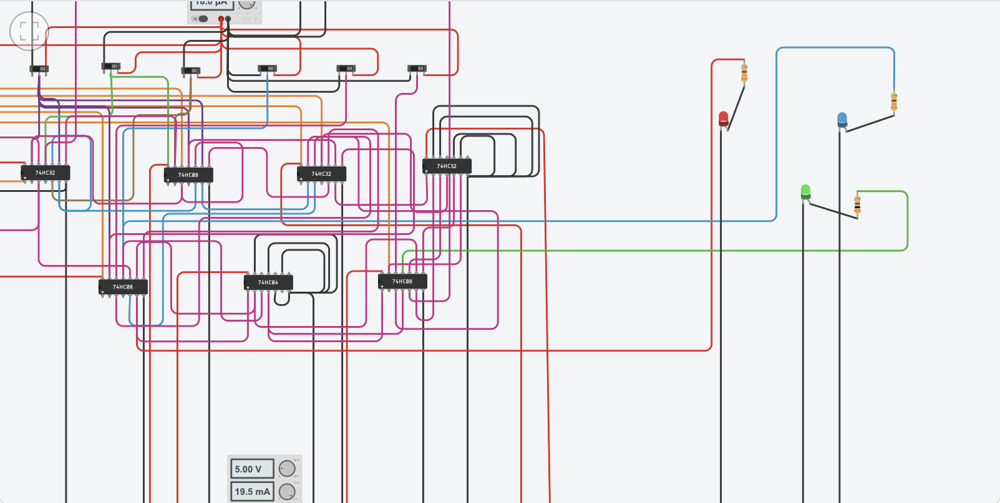
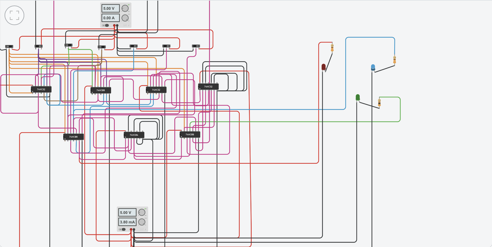

# Priority-Based Power Load Controller — DLD Project

Digital Logic Design project containing the original five-load FPGA implementation, a separate three-load combinational allocator, Verilog testbenches, constraints for the EDGE Artix-7 FPGA board (XC7A35T-FTG256), and a gate-level Tinkercad build of the three-load allocator.

## Repository layout

```text
DLD-Project/
├── README.md
├── .gitignore
├── docs/                 # Project overview, logic design, parts, test plan
├── fpga/
│   ├── src/              # Seven core modules + fpga_top board wrapper
│   ├── testbenches/      # Five FPGA testbenches
│   └── constraints/      # EDGE Artix-7 board XDC
├── rtl/                  # Separate three-load combinational allocator + testbench
├── simulation/           # Test runner scripts
├── tinkercad/            # Tinkercad build plan
└── images/               # Tinkercad circuit and test screenshots
```

## Original FPGA implementation (`fpga/`)

The FPGA implementation supports five loads with demands L1=5, L2=4, L3=3, L4=4, and L5=2, in descending priority order. Available power is a 5-bit unsigned input (0–31). The design contains a combinational priority controller, load-state FSM, demand/overload logic (overload shown on an LED), and display driver.

Use `fpga_top` as the board-level synthesis top with `fpga/constraints/EDGE_Artix7_Power_Load_Controller.xdc`, targeting the **EDGE Artix-7 FPGA development board** (part `xc7a35tftg256-1`, 50 MHz clock).

### FPGA results

The design was synthesised, implemented and run on the EDGE Artix-7 board.

| Behavioural simulation (`tb_top_module`) | Running on the board |
|---|---|
|  |  |

In the simulation, available power = 10 and L1, L2, L5 request power (total demand 11, so overload = 1). L1 (5) and L2 (4) are granted; the 1 unit left is not enough for L5 (2), so `load_status` = 11000 and allocated power = 9.

Demo video: [images/fpga-demo.mp4](images/fpga-demo.mp4)

## Separate three-load combinational allocator (`rtl/`)

This is a separate model with loads L1=5, L2=4, L3=3 and a 4-bit available-power input. It is not the same design as the five-load FPGA controller.

## Run simulations

Install Icarus Verilog (`iverilog`, `vvp`) and run from repository root:

```bash
./simulation/run_fpga_tests.sh
./simulation/run_three_load_tests.sh
```

## Tinkercad status

The three-load allocator has been built at gate level (3×74HC08, 3×74HC32, 1×74HC04) and tested in Tinkercad Circuits:
https://www.tinkercad.com/things/4uLk8jznWWk-fantabulous-vihelmo

See `tinkercad/wiring-guide.md` for the pin-by-pin wiring and test table, `tinkercad/schematic.png` for the gate schematic, and `tinkercad/netlist.py` for the exhaustive 128-case check of the wiring.

### Tinkercad results

Loads: L1 = 5 units (red LED), L2 = 4 (blue), L3 = 3 (green). All three requests are ON in each test; the switches set available power P.

| Full circuit (simulation stopped) |
|---|
|  |

| P = 12 (1100): L1 + L2 + L3 = 12, all fit | P = 8 (1000): L1 takes 5, L2 (4) doesn't fit in the 3 left, L3 (3) does |
|---|---|
|  |  |

| P = 4 (0100): L1 (5) doesn't fit, so L2 gets the 4 units |
|---|
|  |

The P = 8 and P = 4 cases show the priority logic skipping a load that doesn't fit and serving the next one instead.
