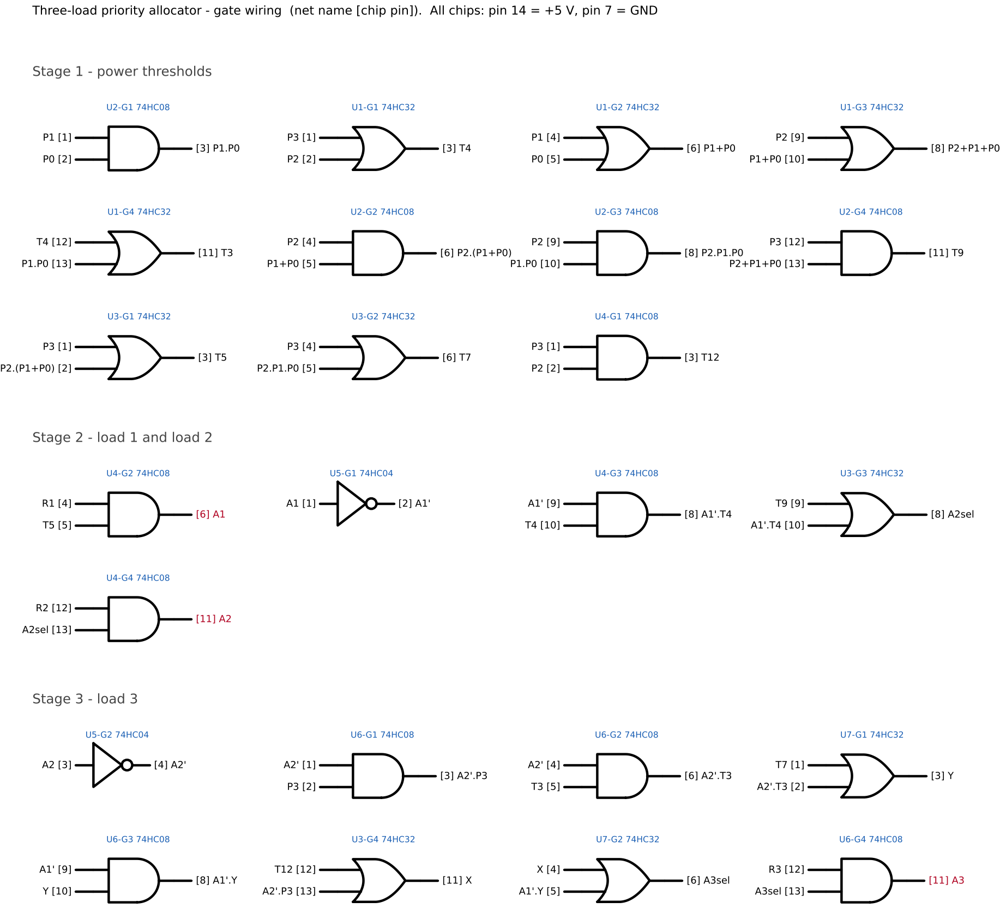

# Tinkercad Wiring Guide — Three-Load Priority Allocator

This is the physical, chip-level version of `rtl/priority_load_controller.v`. It is built from 74HC logic ICs on a breadboard in Tinkercad Circuits. Every pin connection below was generated from `tinkercad/netlist.py`, and that netlist was checked against the greedy priority model for all 128 input combinations (16 power values × 8 request patterns).



## What it does

| Load | Demand | Priority |
|---|---:|---|
| L1 | 5 | Highest |
| L2 | 4 | Medium |
| L3 | 3 | Lowest |

Inputs: available power `P3 P2 P1 P0` (0–15), and requests `R1 R2 R3`.
Outputs: LEDs `A1 A2 A3`. An LED lights when that load is granted. Loads are checked in priority order, and a load is granted only if its full demand fits in the power that is left.

## Equations used (2-input gates only)

```text
T4  = P3 + P2                 T3  = T4 + P1·P0
T5  = P3 + P2·(P1+P0)         T7  = P3 + P2·P1·P0
T9  = P3·(P2+P1+P0)           T12 = P3·P2           (T8 = P3)

A1 = R1 · T5
A2 = R2 · (T9 + A1'·T4)
A3 = R3 · (T12 + A2'·P3 + A1'·(T7 + A2'·T3))
```

These are logically equal to the equations in `docs/logic-design.md`. They are only factored so the circuit fits in 12 AND gates, 10 OR gates and 2 inverters.

## Parts list (Tinkercad component names)

| Qty | Part | Notes |
|---:|---|---|
| 3 | 74HC08 (quad 2-input AND) | U2, U4, U6 |
| 3 | 74HC32 (quad 2-input OR) | U1, U3, U7 |
| 1 | 74HC04 (hex inverter) | U5 |
| 1 | DIP Switch SPST ×8 (or 7 slide switches) | P3, P2, P1, P0, R1, R2, R3 |
| 7 | Resistor 10 kΩ | Pull-downs, one per switch input |
| 3 | LED (e.g. green) | A1, A2, A3 |
| 3 | Resistor 330 Ω | LED series resistors |
| 1 | Power Supply, set to **5 V** | Or use an Arduino Uno's 5V/GND pins |
| 2 | Breadboard (full size) | One for the chips, one for switches and LEDs |

In the Tinkercad components panel, set the filter to **All** and type `74HC08`, `74HC32`, `74HC04`, `DIP` or `Power` into the search box.

## Step-by-step build

### 1. Power rails
1. Place the Power Supply and set it to 5 V (click it to open its settings).
2. Connect **+** to the red (+) rail and **−** to the blue (−) rail on both breadboards. Link the top and bottom rails of each board to each other.

### 2. Place the chips
Place all seven chips across the centre gap of breadboard 1, in this order from left to right: **U1, U2, U3, U4, U5, U6, U7**. Leave 2–3 empty columns between chips. Keep the notch / pin 1 on the **left** for every chip: pins 1–7 are in the bottom row (left to right) and pins 14–8 are in the top row (left to right).

> Tip: in Tinkercad, hovering over any IC pin shows its pin name and number. Check it before each wire.

### 3. Power every chip
On **every** chip, wire **pin 14 → +5 V** and **pin 7 → GND**. Do this for all seven chips before any logic wiring.

### 4. Input switches (with pull-downs)
For each of the 7 switches:
- Connect one side of the switch to **+5 V**.
- The other side is the signal node (`P3`, `P2`, `P1`, `P0`, `R1`, `R2`, `R3`). Connect a **10 kΩ resistor from that node to GND**.

Switch ON = logic 1 and switch OFF = logic 0. Without the pull-down, an OFF input floats. This is the same "no valid HIGH/LOW" problem the earlier breadboard attempt had.

### 5. Output LEDs
For each of `A1`, `A2`, `A3`: connect chip output pin → **330 Ω** → LED **anode (+, long/bent leg)**, then LED **cathode (−)** → GND.

### 6. Logic wiring — follow this table chip by chip
Work one chip at a time and tick off each pin. "in ← X" means wire this pin to wherever net X comes from (see the net list in step 7).

#### U1 — 74HC32 (OR)

| Pin | Connect to |
|---:|---|
| 1 | in ← P3 |
| 2 | in ← P2 |
| 3 | out → T4 |
| 4 | in ← P1 |
| 5 | in ← P0 |
| 6 | out → P1+P0 |
| 7 | GND |
| 8 | out → P2+P1+P0 |
| 9 | in ← P2 |
| 10 | in ← P1+P0 |
| 11 | out → T3 |
| 12 | in ← T4 |
| 13 | in ← P1.P0 |
| 14 | +5 V |

#### U2 — 74HC08 (AND)

| Pin | Connect to |
|---:|---|
| 1 | in ← P1 |
| 2 | in ← P0 |
| 3 | out → P1.P0 |
| 4 | in ← P2 |
| 5 | in ← P1+P0 |
| 6 | out → P2.(P1+P0) |
| 7 | GND |
| 8 | out → P2.P1.P0 |
| 9 | in ← P2 |
| 10 | in ← P1.P0 |
| 11 | out → T9 |
| 12 | in ← P3 |
| 13 | in ← P2+P1+P0 |
| 14 | +5 V |

#### U3 — 74HC32 (OR)

| Pin | Connect to |
|---:|---|
| 1 | in ← P3 |
| 2 | in ← P2.(P1+P0) |
| 3 | out → T5 |
| 4 | in ← P3 |
| 5 | in ← P2.P1.P0 |
| 6 | out → T7 |
| 7 | GND |
| 8 | out → A2sel |
| 9 | in ← T9 |
| 10 | in ← A1'.T4 |
| 11 | out → X |
| 12 | in ← T12 |
| 13 | in ← A2'.P3 |
| 14 | +5 V |

#### U4 — 74HC08 (AND)

| Pin | Connect to |
|---:|---|
| 1 | in ← P3 |
| 2 | in ← P2 |
| 3 | out → T12 |
| 4 | in ← R1 |
| 5 | in ← T5 |
| 6 | out → **A1** (also to LED A1) |
| 7 | GND |
| 8 | out → A1'.T4 |
| 9 | in ← A1' |
| 10 | in ← T4 |
| 11 | out → **A2** (also to LED A2) |
| 12 | in ← R2 |
| 13 | in ← A2sel |
| 14 | +5 V |

#### U5 — 74HC04 (NOT)

| Pin | Connect to |
|---:|---|
| 1 | in ← A1 |
| 2 | out → A1' |
| 3 | in ← A2 |
| 4 | out → A2' |
| 5, 9, 11, 13 | unused inputs → **GND** |
| 6, 8, 10, 12 | unused outputs → leave open |
| 7 | GND |
| 14 | +5 V |

#### U6 — 74HC08 (AND)

| Pin | Connect to |
|---:|---|
| 1 | in ← A2' |
| 2 | in ← P3 |
| 3 | out → A2'.P3 |
| 4 | in ← A2' |
| 5 | in ← T3 |
| 6 | out → A2'.T3 |
| 7 | GND |
| 8 | out → A1'.Y |
| 9 | in ← A1' |
| 10 | in ← Y |
| 11 | out → **A3** (to LED A3) |
| 12 | in ← R3 |
| 13 | in ← A3sel |
| 14 | +5 V |

#### U7 — 74HC32 (OR)

| Pin | Connect to |
|---:|---|
| 1 | in ← T7 |
| 2 | in ← A2'.T3 |
| 3 | out → Y |
| 4 | in ← X |
| 5 | in ← A1'.Y |
| 6 | out → A3sel |
| 7 | GND |
| 9, 10, 12, 13 | unused inputs → **GND** |
| 8, 11 | unused outputs → leave open |
| 14 | +5 V |

### 7. Same wiring, listed by net (use this to double-check)
Each row is one electrical node: one source and every pin it must reach.

| Net | From | To |
|---|---|---|
| `P3` | switch P3 | U1-1, U2-12, U3-1, U3-4, U4-1, U6-2 |
| `P2` | switch P2 | U1-2, U1-9, U2-4, U2-9, U4-2 |
| `P1` | switch P1 | U2-1, U1-4 |
| `P0` | switch P0 | U2-2, U1-5 |
| `R1` | switch R1 | U4-4 |
| `R2` | switch R2 | U4-12 |
| `R3` | switch R3 | U6-12 |
| `P1.P0` | U2-3 | U1-13, U2-10 |
| `T4` | U1-3 | U1-12, U4-10 |
| `P1+P0` | U1-6 | U1-10, U2-5 |
| `P2+P1+P0` | U1-8 | U2-13 |
| `T3` | U1-11 | U6-5 |
| `P2.(P1+P0)` | U2-6 | U3-2 |
| `P2.P1.P0` | U2-8 | U3-5 |
| `T9` | U2-11 | U3-9 |
| `T5` | U3-3 | U4-5 |
| `T7` | U3-6 | U7-1 |
| `T12` | U4-3 | U3-12 |
| `A1` | U4-6 | U5-1, LED A1 (via 330 Ω) |
| `A1'` | U5-2 | U4-9, U6-9 |
| `A1'.T4` | U4-8 | U3-10 |
| `A2sel` | U3-8 | U4-13 |
| `A2` | U4-11 | U5-3, LED A2 (via 330 Ω) |
| `A2'` | U5-4 | U6-1, U6-4 |
| `A2'.P3` | U6-3 | U3-13 |
| `A2'.T3` | U6-6 | U7-2 |
| `Y` | U7-3 | U6-10 |
| `A1'.Y` | U6-8 | U7-5 |
| `X` | U3-11 | U7-4 |
| `A3sel` | U7-6 | U6-13 |
| `A3` | U6-11 | LED A3 (via 330 Ω) |

Wiring tip: run the 7 input signals (P3–R3) as horizontal "bus" wires above the chips, then drop short wires down to each pin. Colour-code wires: red = +5 V, black = GND, and one colour per input signal.

## Test procedure

Click **Start Simulation** and set the switches for each row. All of these expected values come from the verified model.

| P | P3 P2 P1 P0 | R1 R2 R3 | A1 A2 A3 | What it checks |
|---:|---|---|---|---|
| 0 | 0 0 0 0 | 1 1 1 | 0 0 0 | No power, nothing granted |
| 3 | 0 0 1 1 | 0 0 1 | 0 0 1 | L3 alone just fits |
| 3 | 0 0 1 1 | 1 1 1 | 0 0 1 | L1/L2 too big, L3 still served |
| 4 | 0 1 0 0 | 1 1 1 | 0 1 0 | L1 skipped, L2 fits exactly |
| 4 | 0 1 0 0 | 1 0 0 | 0 0 0 | L1 needs 5 |
| 5 | 0 1 0 1 | 1 1 1 | 1 0 0 | L1 takes all 5 |
| 6 | 0 1 1 0 | 0 1 1 | 0 1 0 | L2 takes 4, 2 left < 3 |
| 7 | 0 1 1 1 | 1 1 1 | 1 0 0 | 2 left after L1, not enough for L2 or L3 |
| 8 | 1 0 0 0 | 1 1 1 | 1 0 1 | L2 skipped (3 left), L3 fits |
| 9 | 1 0 0 1 | 1 1 0 | 1 1 0 | L1 + L2 exactly |
| 9 | 1 0 0 1 | 1 1 1 | 1 1 0 | 0 left for L3 |
| 12 | 1 1 0 0 | 1 1 1 | 1 1 1 | All three fit (5+4+3) |
| 12 | 1 1 0 0 | 0 1 1 | 0 1 1 | No L1 request |
| 15 | 1 1 1 1 | 1 1 1 | 1 1 1 | Full power |

If a row fails, use the multimeter in Tinkercad to probe the intermediate nets for that row (T3…T12, then A1', A2', X, Y). Compare each against its equation. That points to the miswired gate.

To regenerate every table after changing the design: `python3 tinkercad/netlist.py` (it also re-runs the 128-case check) and `python3 tinkercad/draw_schematic.py` (needs `pip install schemdraw`).
